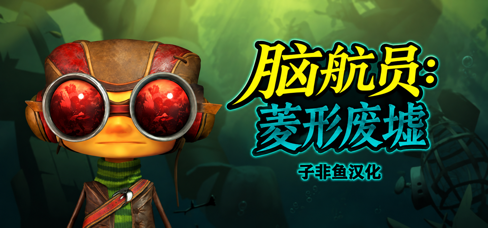

[子非鱼Ai汉化]《脑航员：菱形废墟》/《Psychonauts in the Rhombus of Ruin》
========================================================

Steam商店: https://store.steampowered.com/app/788690/

下载与反馈
下载地址:https://github.com/zfyu222/psychonauts-in-the-rhombus-of-ruin-hanhua/releases/
或者网盘链接: https://pan.baidu.com/s/57TjFsgeU0n2DpyUHI6goNA
请订阅github地址或者网盘地址，以便在补丁更新时获得通知
有问题请反馈至【腾讯文档】脑航员菱形废墟汉化问题收集
https://docs.qq.com/sheet/DTmZsdGpWS2pxeFRL?tab=BB08J2

游戏介绍
这是一款 VR 冒险解谜游戏。你将扮演少年特工拉兹，在神秘海域运用超能力搜寻线索、联系伙伴，并设法救出脑航员首领。

安装汉化
解压到游戏根目录，双击“安装汉化.cmd”，然后在 Steam 启动选项中填写 -culture=en。

补丁升级
覆盖解压新版补丁后运行“安装汉化.cmd”。

卸载汉化
双击“卸载汉化.cmd”。

适用版本
Steam Build 10833373
Windows VR

汉化内容
剧情对白、字幕、菜单、启动提示与场景贴图的简体中文。

说明
本补丁使用 AI 辅助翻译，请适当降低预期。

发布日期：2026-11-11

更新日志
- v1.0（2026-11-11）：首次发布。
